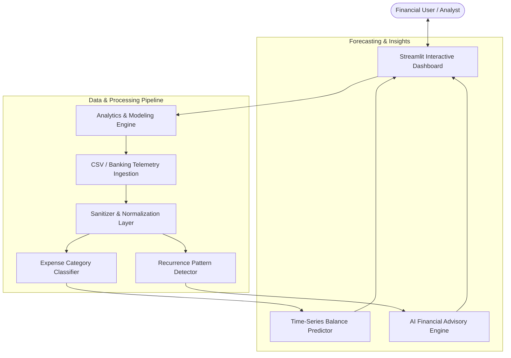

# ⚡ MyBudgetAI — Intelligent Financial Analytics & Expense Optimization Engine

<div align="center">

[](https://python.org)
[](https://streamlit.io)
[](https://scikit-learn.org)
[](https://plotly.com)
[](LICENSE)
[](https://github.com/SparkSidd)

**AI-Driven Personal Financial Intelligence, Recurring Outflow Detection & Cash Flow Forecasting.**

[Overview](#-overview) • [System Features](#-features--capabilities) • [Technical Architecture](#-technical-architecture) • [Quick Start](#-quick-start)

</div>

---

## 📌 Overview

MyBudgetAI is an interactive personal wealth intelligence platform combining statistical cash flow modeling, machine learning clustering for automated merchant categorization, and AI-assisted financial advisory. It replaces cumbersome spreadsheets with predictive expense projection and interactive anomaly detection.

---

## 🚀 Features & Capabilities

- **📊 Dynamic Visual Analytics**: Real-time breakdown of cash flow velocity, burn rate, and category distributions using interactive Plotly charts.
- **🔄 Automated Recurring Charge Detection**: Fourier analysis and temporal recurrence algorithms to detect hidden subscriptions, SaaS fees, and recurring utility bills.
- **🎯 Dynamic Savings Goal Allocation**: Monte Carlo simulation evaluating portfolio achievement probabilities given historical income variance.
- **📈 Cash Flow Forecasting**: Time-series predictive modeling forecasting end-of-month liquidity balances.
- **🤖 AI Financial Strategist**: Context-grounded recommendations tailored to savings goals, discretionary spending limits, and emergency fund buffer targets.

---

## 🏗️ Technical Architecture



---

## ⚡ Quick Start

```bash
# 1. Create and activate virtual environment
python -m venv mybudget-env
source mybudget-env/bin/activate  # Windows: mybudget-env\Scripts\activate

# 2. Install dependencies
pip install -r requirements.txt

# 3. Launch application
streamlit run app.py
```

---

## 📄 License
This project is open-source under the MIT License.
